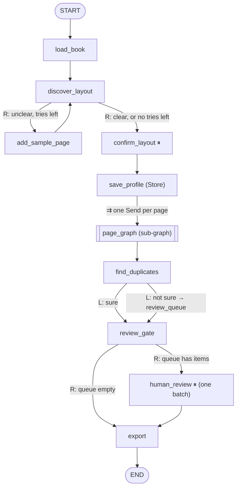
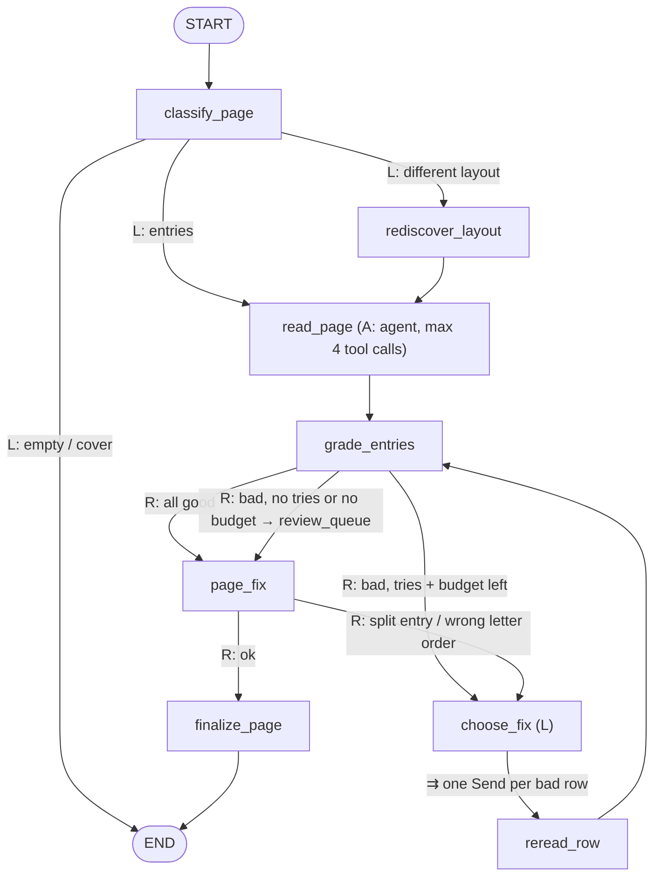

# Graph topology

Status: accepted (PR #1, 2026-10-12).

Legend: **R** = rule router, **L** = LLM router, **A** = ReAct agent,
⏸ = `interrupt` (human), ⇉ = `Send` (parallel fan-out).

## Book graph (parent)

| Node | Does | LangGraph concept |
|---|---|---|
| `load_book` | lists page images, picks 2-3 sample pages | plain node |
| `discover_layout` | vision LLM builds `LayoutProfile` | structured output, sets `layout_clear` |
| `add_sample_page` | adds one more sample page (furthest from the others) | loop back; the counter is `len(sample_pages)` |
| `confirm_layout` | shows profile, user accepts or edits it | `interrupt` + `Command(resume=...)` |
| `save_profile` | saves profile per book | `Store` |
| (edge) | `Send("page_graph", {...})` per page | map-reduce |
| `page_graph` | see below | sub-graph as a node |
| `find_duplicates` | same person on 2 pages? | LLM router |
| `review_gate` / `human_review` | ask once for all doubtful entries | conditional edge + `interrupt` |
| `export` | Excel + `.vcf` | plain node |

## Page sub-graph

| Node | Does | LangGraph concept |
|---|---|---|
| `classify_page` | entries / empty / cover / different layout | LLM router |
| `rediscover_layout` | layout for this page only | reuses the discovery prompt |
| `read_page` | agent reads the whole page in one call, uses tools (small crops) only when unsure | ReAct agent (its own small sub-graph) |
| `grade_entries` | Python rules first; LLM check only if rules can't decide. Sets `confidence` and `issues` | conditional edge on scores, tries and budget |
| `choose_fix` | picks a fix from the grader's reason (zoom, 3-row window, stronger model) | LLM router + nested `Send` |
| `reread_row` | reads one row with the chosen view | map-reduce inside a sub-graph |
| `page_fix` | merges entries split over 2 rows, checks letter order | rule router |
| `finalize_page` | writes `contacts`, `review_queue`, `decisions` | sub-graph output → parent reducers |

## Loop and cost limits

- `discover_layout`: max 2 extra tries.
- `grade_entries` → `choose_fix` → `reread_row`: max `max_attempts` per row (default 3).
- `page_fix` → `choose_fix`: once per page.
- `read_page`: max 4 tool calls per page.
- Budget: a row is retried only while the page spent less than `page_budget_usd`
  ([decision 0007](../decisions/0007-cost-control.md)).

## Models and cost

- Every LLM node reads its model from `config["configurable"]` (cheap by default).
- Every LLM call returns its cost in `cost_usd`; the `add` reducer sums it up to the book.
- Development: LLM answer cache on disk, 3-page test set.
